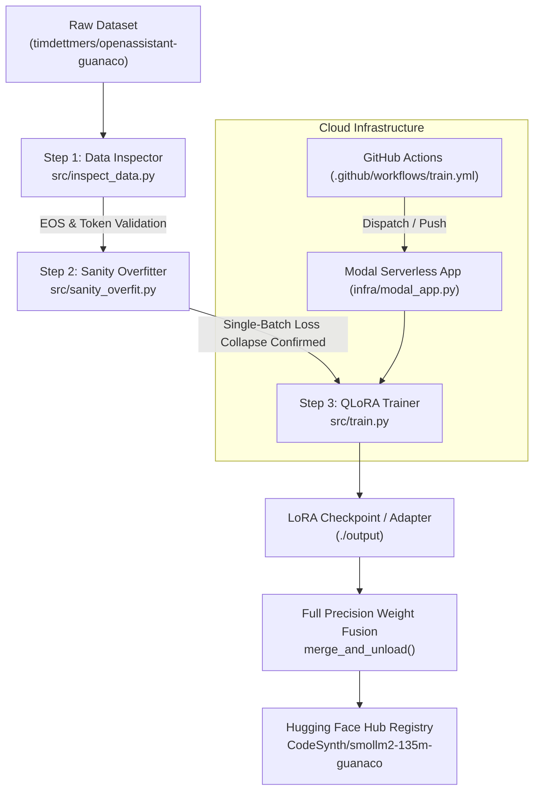

# 🚀 LoRA-Orchestrator: Autonomous QLoRA Pipeline & Serverless CI/CD

[](https://huggingface.co/CodeSynth/smollm2-135m-guanaco)
[](https://www.python.org/downloads/)
[](https://pytorch.org/)
[](https://modal.com/)
[](LICENSE)

An end-to-end, production-grade autonomous fine-tuning system designed to train, evaluate, fuse, and deploy parameter-efficient Large Language Models (LLMs) with zero silent failures.

The pipeline fine-tunes **SmolLM2-135M** on the **OpenAssistant Guanaco** instruction dataset via 4-bit **QLoRA** (`bitsandbytes`), tracks telemetry in **Weights & Biases**, fuses LoRA adapters into 16-bit safetensors, and automatically publishes the weights to the [Hugging Face Hub](https://huggingface.co/CodeSynth/smollm2-135m-guanaco).

---

## 🌟 Key Highlights

- **Anti-Silent-Failure Methodology**: Strict local verification stages (token/EOS inspection, single-batch loss collapse) before any cloud GPU compute is triggered.
- **Turing & Modern GPU Robustness**: Custom precision orchestration (`bnb_4bit_compute_dtype=torch.float16`, adapter parameters in `fp32`) preventing PyTorch BFloat16 kernel faults and AMP `GradScaler` unscale errors on Tesla T4 / Turing GPUs.
- **Automated Weight Fusion**: Automatically reloads base weights in FP16, attaches adapter checkpoints, performs `merge_and_unload()`, and publishes full standalone safetensors.
- **Serverless Cloud & CI/CD**: Cloud-native deployment via **Modal** serverless containers and automated GitHub Actions workflow triggers.
- **Ultra-Lightweight Inference**: Runs on standard consumer CPUs (e.g. Intel Core i7) with fast token generation latency (<270 MB memory footprint).

---

## 🏗️ Architecture & Verification Flow



---

## 📁 Repository Structure

```text
.
├── .github/
│   └── workflows/
│       └── train.yml       # Step 5: Automated GitHub Actions CI/CD trigger
├── infra/
│   └── modal_app.py        # Step 4: Serverless GPU container & Modal execution
├── src/
│   ├── inspect_data.py     # Step 1: Raw token & EOS formatting verification
│   ├── sanity_overfit.py   # Step 2: Single-batch gradient & loss collapse test
│   ├── train.py            # Step 3: Production QLoRA SFTTrainer + Hub publisher
│   └── inference.py        # Local CPU/GPU inference runner
├── requirements.txt        # Python dependency specification
├── .env.example            # Environment variable template
└── README.md
```

---

## ⚙️ Installation & Environment Setup

### 1. Clone & Set Up Virtual Environment

```bash
git clone https://github.com/ParthSharma-2/LoRA-Orchestrator.git
cd LoRA-Orchestrator

# Create and activate virtual environment
python -m venv .venv

# On Linux/macOS:
source .venv/bin/activate
# On Windows (PowerShell):
.venv\Scripts\Activate.ps1
```

### 2. Install Dependencies

```bash
pip install --upgrade pip
pip install -r requirements.txt
```

### 3. Configure API Secrets

Copy `.env.example` to `.env` and fill in your tokens:

```bash
cp .env.example .env
```

```ini
HF_TOKEN=hf_your_huggingface_write_token
WANDB_API_KEY=your_wandb_api_key
MODAL_TOKEN_ID=your_modal_token_id
MODAL_TOKEN_SECRET=your_modal_token_secret
HF_MODEL_ID=HuggingFaceTB/SmolLM2-135M
HF_DATASET=timdettmers/openassistant-guanaco
OUTPUT_REPO_ID=CodeSynth/smollm2-135m-guanaco
```

---

## 🧪 Pipeline Execution Guide

### Step 1: Raw Data & Tokenization Inspection
Ensures prompts match the target template, EOS tokens are correctly placed, and no label masks (`-100`) discard critical training data:

```bash
python src/inspect_data.py --model_id HuggingFaceTB/SmolLM2-135M --dataset_name timdettmers/openassistant-guanaco
```

### Step 2: Single-Batch Sanity Overfitting
Proves that the model architecture, PEFT adapter injection, optimizer, and loss calculation learn correctly on a single batch:

```bash
python src/sanity_overfit.py --steps 50 --batch_size 2 --learning_rate 5e-4
```
*Expected result:* Initial loss (~2.5–3.5) collapses down to near zero (< 0.15), proving healthy gradient backpropagation.

### Step 3: Production QLoRA Training & Hub Merge
Trains the model with 4-bit NF4 quantization, saves LoRA adapters, fuses weights with `SmolLM2-135M`, and uploads to Hugging Face Hub:

```bash
python src/train.py \
    --model_id HuggingFaceTB/SmolLM2-135M \
    --dataset_name timdettmers/openassistant-guanaco \
    --output_dir ./output \
    --epochs 1 \
    --batch_size 4 \
    --learning_rate 2e-4 \
    --merge_and_push \
    --hub_model_id CodeSynth/smollm2-135m-guanaco
```

---

## ☁️ Serverless Execution (Modal)

To run the training remotely on serverless NVIDIA A10G / T4 GPUs without managing virtual machines:

```bash
# Authenticate with Modal
modal setup

# Launch remote training job
modal run infra/modal_app.py --epochs 1 --batch-size 4 --gpu A10G --push-to-hub
```

---

## 💻 Running Inference Locally (CPU / GPU)

You can run text generation directly against the published model from the Hugging Face Hub:

### Using the Included Inference Script

```bash
python src/inference.py \
    --model_id CodeSynth/smollm2-135m-guanaco \
    --prompt "### Human: What are the benefits of serverless computing for machine learning?\n### Assistant:" \
    --max_new_tokens 128 \
    --temperature 0.7
```

### Using Python & `transformers`

```python
import torch
from transformers import AutoTokenizer, AutoModelForCausalLM

model_id = "CodeSynth/smollm2-135m-guanaco"

# Automatic device selection (CUDA or CPU)
device = "cuda" if torch.cuda.is_available() else "cpu"
torch_dtype = torch.float16 if torch.cuda.is_available() else torch.float32

tokenizer = AutoTokenizer.from_pretrained(model_id)
model = AutoModelForCausalLM.from_pretrained(
    model_id,
    torch_dtype=torch_dtype,
    device_map=device
)

prompt = "### Human: How does quantization reduce LLM memory footprint?\n### Assistant:"
inputs = tokenizer(prompt, return_tensors="pt").to(device)

with torch.no_grad():
    output_tokens = model.generate(
        **inputs,
        max_new_tokens=150,
        temperature=0.7,
        top_p=0.9,
        do_sample=True,
        pad_token_id=tokenizer.eos_token_id
    )

response = tokenizer.decode(output_tokens[0], skip_special_tokens=True)
print(response)
```

---

## 📊 Hyperparameters & Configuration

| Parameter | Value | Description |
| :--- | :--- | :--- |
| **Base Model** | `HuggingFaceTB/SmolLM2-135M` | 135 Million parameters, Causal LM |
| **Dataset** | `timdettmers/openassistant-guanaco` | Multi-turn conversational instruction dataset |
| **Prompt Format** | Guanaco (`### Human: ...\n### Assistant:`) | Standard instruction format |
| **Quantization** | 4-bit NF4 (`bitsandbytes`) | Double quantization enabled |
| **Compute Dtype** | `float16` | High throughput on Tensor Cores |
| **LoRA Rank ($r$)** | `16` | Adapter dimension |
| **LoRA Alpha ($\alpha$)** | `32` | Scaling factor ($\alpha / r = 2.0$) |
| **LoRA Dropout** | `0.05` | Regularization |
| **Target Modules** | `q_proj, k_proj, v_proj, o_proj, gate_proj, up_proj, down_proj` | All linear attention & MLP projections |
| **Optimizer** | `paged_adamw_32bit` | Page-locked memory management |
| **Learning Rate** | `2e-4` | Cosine decay schedule with warmup |

---

## 📜 License

This project is licensed under the [Apache 2.0 License](LICENSE).
Base model SmolLM2 is provided under Apache 2.0 by Hugging Face.
Dataset OpenAssistant Guanaco is distributed under Apache 2.0.
